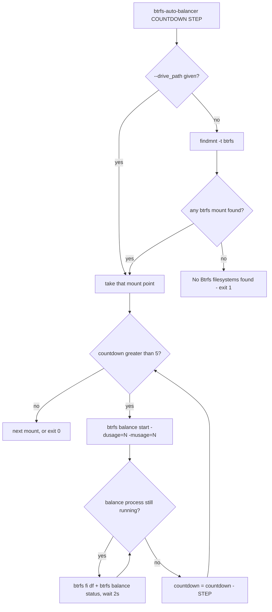

# Btrfs Auto Balancer (btrfs-auto-balancer)

[](https://github.com/sponsors/kevinveenbirkenbach) [](https://www.patreon.com/c/kevinveenbirkenbach) [](https://buymeacoffee.com/kevinveenbirkenbach) [](https://s.veen.world/paypaldonate)

[](https://www.gnu.org/licenses/agpl-3.0)
[](https://www.python.org)
[](https://github.com/kevinveenbirkenbach/btrfs-auto-balancer/stargazers)
[](https://github.com/kevinveenbirkenbach/btrfs-auto-balancer/network)

**Btrfs Auto Balancer** is a Python utility that automates the balancing process for Btrfs filesystems. It dynamically adjusts usage thresholds while providing real-time status updates, ensuring efficient storage utilization and improved system performance on your Linux system. ⚙️💾

## 🧭 How it works



`btrfs-auto-balancer 20 5` therefore runs three passes, at `-dusage=20`, `15` and `10`, and stops before reaching the minimum of `5`.

## 🎯 Purpose

Btrfs Auto Balancer simplifies Btrfs volume maintenance by automating the balance process. It dynamically decrements usage thresholds (for both data and metadata) and displays real-time status updates during balancing operations. Whether you're managing a single drive or all mounted Btrfs filesystems, this tool helps keep your system optimized.

## 🚀 Features

- **Dynamic Balancing:** Automatically decrements disk usage thresholds during balancing operations. 🔄
- **Real-Time Monitoring:** Continuously displays current Btrfs filesystem status and balance progress. 📊
- **Multi-Drive Support:** Balances a specific drive if provided, or processes all mounted Btrfs volumes if no drive is specified. 💻
- **Flexible Parameters:** Easily adjust initial thresholds and decrement steps to suit your system's needs. 🔧

## 🛠 Requirements

- **Python 3.10+** 🐍
- **Linux Operating System** 🐧
- **`findmnt`** on `PATH` — discovers the mounted Btrfs filesystems (`util-linux`)
- **`btrfs`** on `PATH` — runs the balance and reports its status (`btrfs-progs`)
- **root privileges** for the balance itself

If a required command is missing, the tool exits with code `127` and a one‑line error instead of a traceback.

## 📥 Installation

```bash
pip install btrfs-auto-balancer
```

pip is the single supported installation path.

The package installs **two** identical commands: `btrfs-auto-balancer` (primary) and `btrfsauba` (kept for older documentation and scripts).

## 🚀 Usage

### Balancing a Specific Btrfs Drive

```bash
sudo btrfs-auto-balancer <countdown> <count_down_step> --drive_path <drive_path>
```

### Balancing All Mounted Btrfs Drives

```bash
sudo btrfs-auto-balancer <countdown> <count_down_step>
```

Replace `<countdown>` with the initial usage threshold (for both data and metadata) and `<count_down_step>` with the decrement step for each balance iteration. Both must be **greater than zero** — a step of `0` would loop forever and is rejected.

Balancing stops once the threshold drops to `5` or below. `btrfs-auto-balancer 20 5` therefore runs three passes, at `-dusage=20`, `15` and `10`.

### Exit codes

| Code | Meaning |
| --- | --- |
| `0` | Finished. |
| `1` | No Btrfs filesystem was found. |
| `2` | Invalid command line arguments, including a countdown or step of zero or less. |
| `127` | A required command is not installed. |

## 🧪 Development

```bash
make lint              # ruff check + ruff format --check
make format            # apply ruff format
make test              # unit + integration tests
make test-unit
make test-integration
make test-e2e          # install the package in a container and exercise the CLI
```

Tests run against the working tree — the `Makefile` puts `src/` on `PYTHONPATH`, so no install is needed. The integration tests stub `findmnt` on `PATH`, so no real filesystem is ever touched.

## 📜 License

This project is licensed under the GNU Affero General Public License v3.0. See the [LICENSE](./LICENSE) file for details.

## 👨‍💻 Author

Developed by **Kevin Veen-Birkenbach**

- Email: [kevin@veen.world](mailto:kevin@veen.world)
- Website: [https://www.veen.world/](https://www.veen.world/)

---

Happy balancing! ⚖️💡
